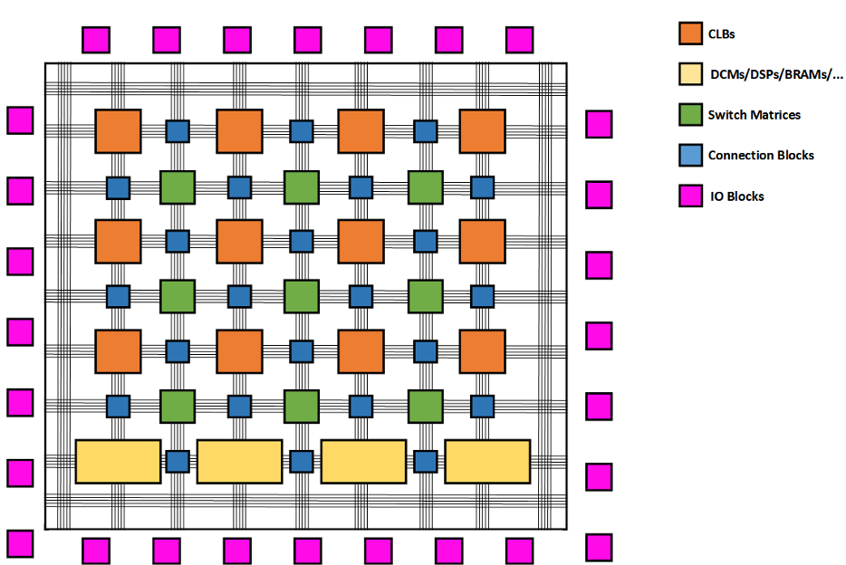
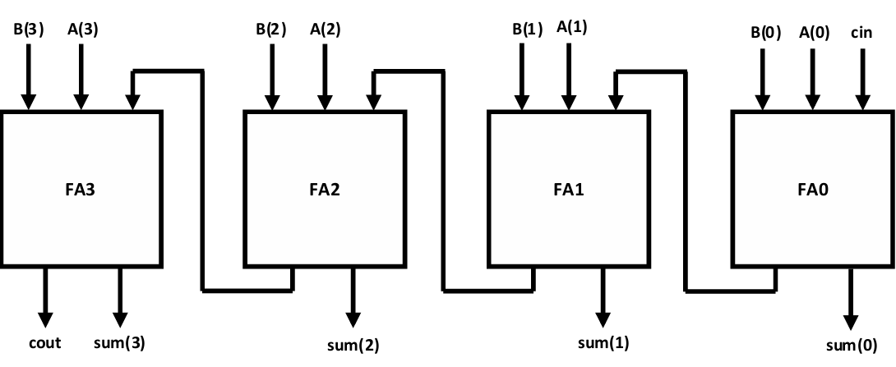
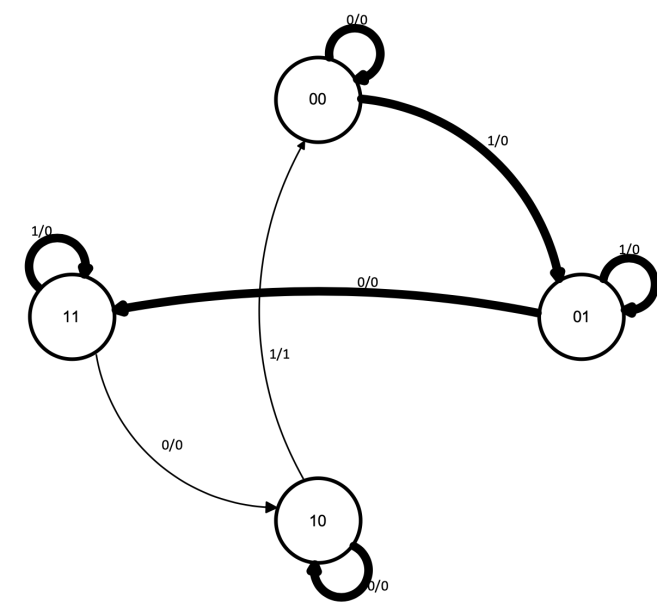
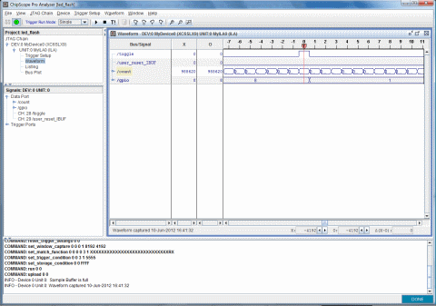
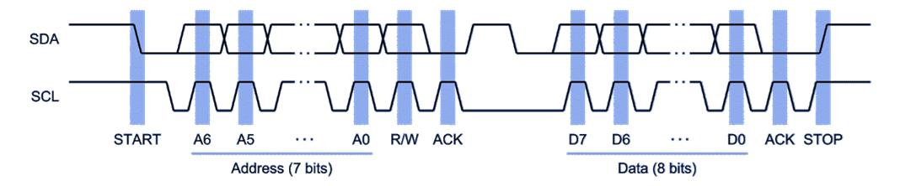

# FPGA & VHDL Laboratory Manual

**Computer Components Laboratory | Academic technical documentation | 12 laboratory exercises**

## Project overview

This project documents the development and comprehensive revision of a **103-page undergraduate laboratory manual** for a Computer Components Laboratory course. The manual is structured as a guided introduction to **digital hardware design on FPGAs**, combining essential theory, VHDL descriptions, simulation procedures, and hands-on hardware exercises.

Rather than presenting isolated circuit examples, the material follows a learning path: understanding FPGA resources, expressing digital circuits in VHDL, testing their behavior, and finally interfacing an FPGA with external devices. The laboratory environment described in the manual uses **Xilinx ISE** and a **Spartan-3 FPGA** development board.

## What the manual covers

The manual is organized into **12 progressive experiments**:

| Lab | Subject | Main learning focus |
|:--:|---|---|
| 01 | Introduction to FPGAs | FPGA architecture, programmable logic, and VHDL fundamentals |
| 02 | Combinational circuit design | Xilinx ISE workflow, structural VHDL, modular circuits, and simulation |
| 03 | Behavioral combinational design | Operators and behavioral constructs for describing logic |
| 04 | Sequential circuits | VHDL processes, conditional statements, loops, and signal/variable behavior |
| 05 | Synchronous sequential circuits | Clocked logic and practical synchronous design concepts |
| 06 | IP cores | Integrating prebuilt IP and using clock-management resources (DCM) |
| 07 | Finite-state machines | Modeling states and transitions and implementing an FSM in VHDL |
| 08 | Stepper motor control | Full-step and half-step sequencing and hardware interfacing |
| 09 | RS232 communication | Serial communication principles and transmitter-interface design |
| 10 | SPI communication | SPI signaling and interface-circuit design |
| 11 | I2C communication | I2C transactions, data framing, and interface design |
| 12 | Character LCD interfacing | Driving a 16×2 character LCD from digital hardware |

Each topic is presented as instructional material rather than a claim that this repository contains completed hardware implementations for all 12 experiments.

## Educational approach

The manual links **theoretical explanations**, **circuit and state diagrams**, **VHDL-oriented design workflows**, and **simulation/implementation guidance**. Its goal is to help students move from writing a hardware description to inspecting behavior in a simulator and understanding how the design maps to an FPGA-based system.

## Selected technical figures

The following illustrations are **selected figures from the manual**, shown only to communicate the scope of the work. They are not full pages or a substitute for the complete instructions.

### FPGA architecture and digital logic

| FPGA architecture | Four-bit modular adder |
|:---:|:---:|
|  |  |
| Configurable FPGA fabric and resources | Hierarchical combinational circuit design |

### Sequential logic and verification

| Finite-state machine | Xilinx ISE simulation |
|:---:|:---:|
|  |  |
| Example state-transition representation | Design verification in the laboratory toolchain |

### Digital communication

*Example of I2C signaling and data framing addressed in the communication-interface section.*

## Publication scope

**The complete 103-page laboratory manual is not publicly available.** This repository is a concise portfolio overview with a small selection of illustrative figures. It does **not** publish the original PDF, detailed laboratory instructions, full exercise solutions, or associated FPGA project sources.

The toolchain reflects the historical Spartan-3 / Xilinx ISE laboratory setup and is not presented as a guide to current FPGA tool versions. No open-source license is granted for the underlying manual.
